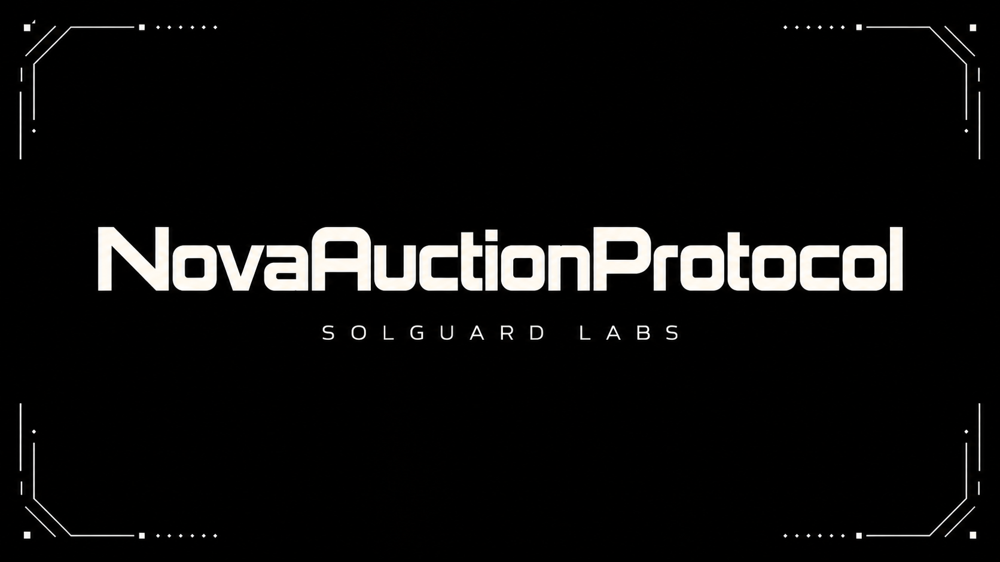
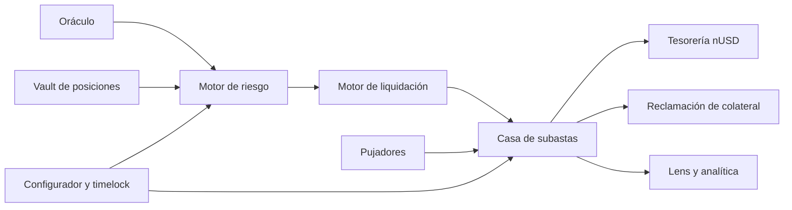

# NovaAuctionProtocol



NovaAuctionProtocol modela subastas EVM de colateral liquidado contra deuda estable nUSD. El motor separa vault, evaluación de riesgo, inicio de subasta, pujas, liquidación de deuda en tesorería y reclamación del colateral. Incluye gobierno parametrizable, pausas, vistas de consulta y analítica de recuperación.

> Esta distribución se ejecuta en Foundry y redes locales de prueba. La rama `production` y el release identifican una revisión del código; no representan un despliegue on-chain ni autorizan gestionar activos reales.

## Arquitectura



`src/core` contiene vault, liquidación y casa de subastas; `src/libraries` concentra cálculos y tipos; `src/treasury` registra recuperación, superávit y déficit; `src/lens` publica vistas de estado y un perfil informativo de recuperación bajo estrés. `src/security` contiene controles de acceso, pausa y reentrada.

## Uso local

Requiere Foundry con `forge` y Git para instalar `forge-std`.

```bash
bash scripts/bootstrap.sh
forge fmt --check
forge build
forge test
bash scripts/ci.sh
```

El script `script/DeployNova.s.sol` sirve como ejemplo de composición de contratos en un entorno local. No se proporcionan direcciones de red pública ni parámetros para transferir fondos reales.

## Ciclo económico

1. Una posición de deuda se evalúa con el oráculo y la configuración de riesgo.
2. El motor de liquidación inicia una subasta con colateral bloqueado y `debtTarget`.
3. Los participantes pujan en nUSD mientras la subasta está activa. Las pujas próximas al cierre pueden ampliar su ventana según la configuración.
4. Al terminar, `settle` registra el importe ganador en tesorería y crea el derecho de reclamación del colateral.
5. El ganador reclama el colateral; los créditos de pujas superadas son recuperables por sus titulares.

La configuración inicial usa duración de 6 horas, ventana de extensión de 15 minutos, extensión de 30 minutos, incremento mínimo del 5 % y pisos de 100 % y 80 % de la deuda objetivo. Los parámetros pueden cambiar mediante el configurador con control de acceso. La analítica de recuperación toma un importe nominal limitado por la deuda objetivo y muestra además una proyección con recorte del 15 %; no afecta a las pujas ni al settlement.

## Documentación

- [Arquitectura y estados](docs/arquitectura.md)
- [Modelo económico](docs/modelo-economico.md)
- [Integración y operación](docs/integracion-operacion.md)
- [Política de seguridad](SECURITY.md)
- [Historial de cambios](CHANGELOG.md)

El CI ejecuta formato, compilación, tests Forge y un recuento informativo de líneas. Tras publicación, `main`, `production` y el tag anotado `v1.0.0` deben resolver al mismo commit.
