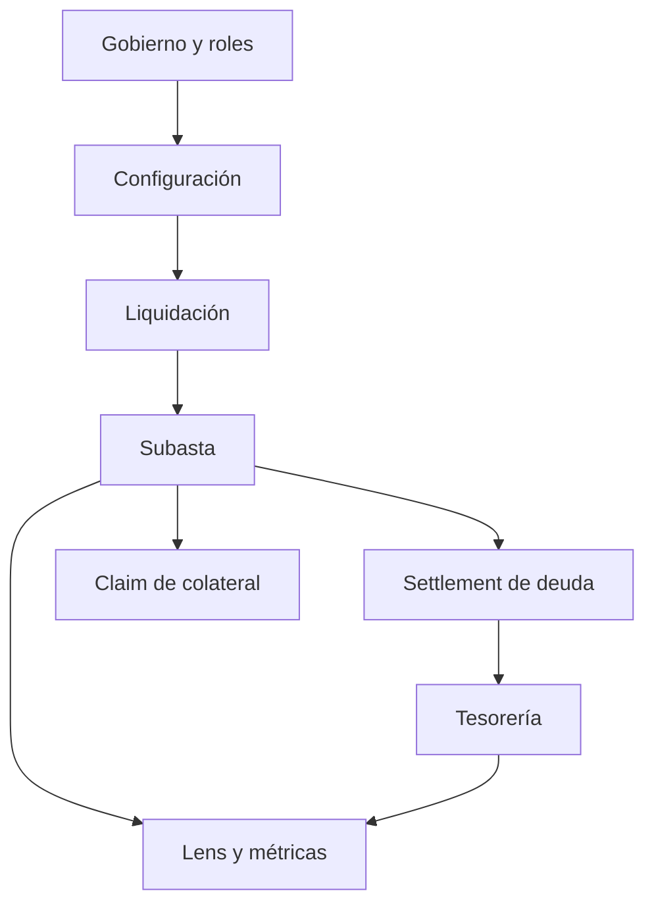

# Política de seguridad

## Alcance

La revisión incluye el vault, motor de liquidación, casa de subastas, tesorería, precios de oráculo, configuración, roles, pausas, tokens y vistas. El script de despliegue es ilustrativo y la suite Foundry usa estado local. No hay despliegue autorizado en redes públicas ni custodia de terceros en esta distribución.

| Control | Evidencia | Límite |
| --- | --- | --- |
| Control de roles | Configurador, auctioneer y pauser separados | La administración sigue siendo sensible |
| Pausa | Detiene determinadas operaciones críticas | No revierte operaciones ya finalizadas |
| Reentrada | Protección en rutas de transferencia | No sustituye revisión de estados |
| Pujas | Estado, tiempo e importe mínimo | Las pruebas conocidas no agotan todos los escenarios |
| Tesorería | Recuperación, superávit y déficit por token | Contabilidad no certifica precio económico |
| Perfil de recuperación | Proyección nominal y recorte hipotético | Consulta informativa, sin bloqueo |

## Validación

Ejecuta `bash scripts/ci.sh` antes de proponer una revisión. Compara configuración, eventos, estado de la subasta y asientos de tesorería; revisa cambios de dependencias y bytecode de contratos económicos. Una suite verde confirma el alcance de las pruebas ejecutadas, no una garantía absoluta de seguridad.

## Reporte responsable

Si encuentras un problema, utiliza el canal privado de avisos de seguridad de GitHub del repositorio cuando esté habilitado. No publiques instrucciones explotables en issues o PR abiertos. Adjunta commit, configuración, secuencia temporal mínima, balances y estado antes/después, resultado esperado y observado e impacto. No incluyas claves privadas ni datos de terceros.
