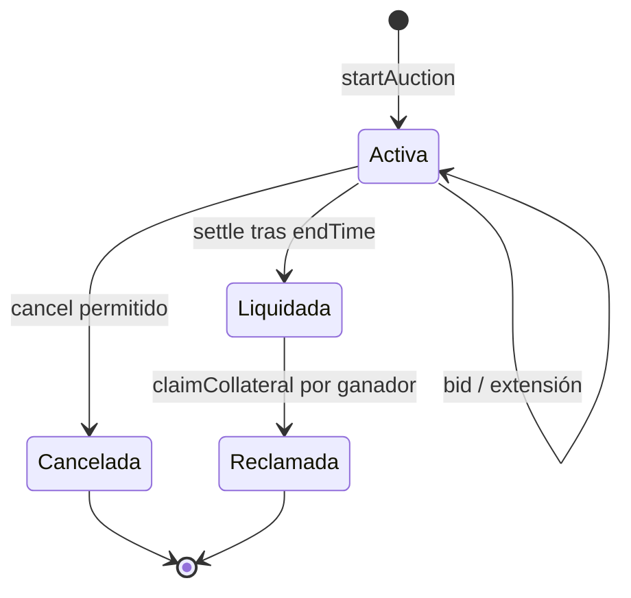

# Arquitectura y estados

`NovaVault` registra posiciones de colateral y deuda. `NovaPriceOracle` aporta el precio; `NovaRiskEngine` evalúa la capacidad y salud de la posición. Cuando corresponde liquidar, `NovaLiquidationEngine` incauta el colateral y solicita una subasta a `NovaAuctionHouse`. El configurador define direcciones, roles y parámetros; `NovaTimelock` es un módulo auxiliar disponible para políticas administrativas que lo integren explícitamente.

Una puja nueva deposita nUSD en la casa de subastas. Si reemplaza a otra, el importe previo pasa a `bidCredit` y su titular puede retirarlo. Al liquidar, el ganador se conserva en el recibo y el nUSD pasa a tesorería; `NovaTreasury` registra deuda recuperada, superávit y déficit. La reclamación del colateral solo corresponde al ganador y respeta `claimDelay`.

`NovaAuctionLens` ofrece consultas por subasta; `NovaAuctionAnalytics` resume recuperación y extensiones. Ambas capas son de solo lectura y no mutan estado económico. Los eventos permiten reconstruir el orden de inicio, pujas, extensiones, liquidación y reclamación, pero deben cotejarse con estado y transferencias.
