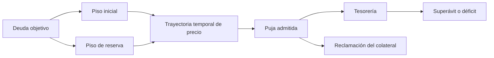

# Modelo económico de subastas

La subasta define `debtTarget`, importe de colateral, tiempo de inicio/cierre y parámetros de piso. El piso inicial es `debtTarget × startFloorBps / 10.000`; el piso de reserva es `debtTarget × reserveFloorBps / 10.000`. Entre inicio y cierre se aplica un descenso temporal con redondeo entero. La configuración inicial establece 10.000 y 8.000 bps respectivamente. Un incremento mínimo para superar la puja vigente es `winningBid × minIncrementBps / 10.000`.

Con deuda objetivo de 1.000 nUSD, los pisos de arranque y reserva son 1.000 y 800 nUSD. Para un cierre con puja ganadora de 1.080 nUSD, tesorería registra 1.000 de recuperación de objetivo y 80 de superávit a favor del borrower según las reglas de crédito. Si el cierre es de 950 nUSD, registra déficit de 50. Estos ejemplos expresan unidades de token; la implementación utiliza 18 decimales para nUSD.

`NovaAuctionAnalytics.recoveryProfile` muestra `nominalRecovery = min(winningBid, debtTarget)`, `shortfall`, `surplus` y un escenario de estrés. El escenario aplica 1.500 bps de recorte a la recuperación nominal: para 1.000 recuperados, la proyección es 850 y el déficit hipotético 150. No cambia fondos ni parámetros de aceptación. `weightedRecoveryBps` pondera la recuperación de un rango por deuda objetivo total; devuelve cero cuando no hay subastas válidas.

No se deben comparar unidades de colateral con nUSD sin precio de oráculo y escala decimal apropiados. Las vistas financieras y el estado de tesorería son complementarios: una proyecta riesgo, la otra registra transferencias ejecutadas.
